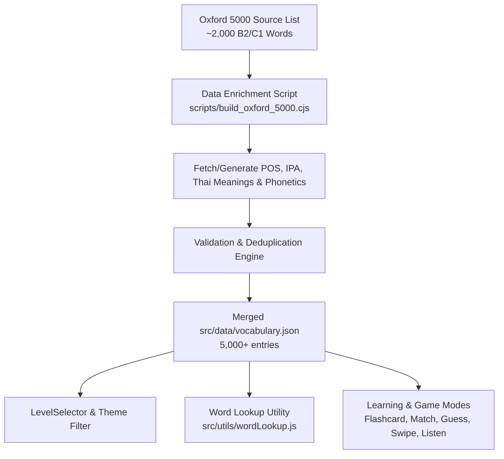

# Oxford 5000 Vocabulary Expansion Design

## 1. Overview & Objectives
Expand the vocabulary dataset in English Study Web from **Oxford 3000** (~2,996 words) to **Oxford 5000** (~5,000+ words), adding extensive coverage of **CEFR B2+ and C1 Advanced** vocabulary.

### Key Goals:
- **Comprehensive Word Bank:** Expand total vocabulary to ~5,000 core English words.
- **Rich Data Attributes:** Every word entry contains:
  - `id`: Unique incremental integer
  - `word`: English headword
  - `level`: CEFR level (`A1`, `A2`, `B1`, `B2`, `C1`)
  - `type`: Part of speech (`n.`, `v.`, `adj.`, `adv.`, etc.)
  - `ipa`: International Phonetic Alphabet pronunciation
  - `meaning`: Accurate Thai definition/translation
  - `thai_pronunciation`: Thai phonetics reading aid
- **Full App Integration:**
  - All interactive modes (Flashcards, Memory Match, Guess, Swipe, Listening, Assemble, POS) seamlessly support Level C1 and 5,000 words.
  - Interactive Short Story Reader lookup instantly resolves C1 vocabulary.
  - UI copy and level selectors updated from "Oxford 3000" to "Oxford 5000 (A1 - C1)".

---

## 2. Architecture & Data Flow



---

## 3. Dataset Specification & Pipeline

### 3.1 Vocabulary JSON Schema (`src/data/vocabulary.json`)
```json
{
  "id": 3001,
  "word": "accumulate",
  "type": "v.",
  "level": "B2",
  "ipa": "əˈkjuːmjəleɪt",
  "meaning": "สะสม, รวบรวม, พอกพูน",
  "thai_pronunciation": "เออะคิวมิวเลท"
}
```

### 3.2 Data Processing & Validation Rules
1. **Deduplication:** Check lowercase headword against existing ~2,996 entries; keep highest-quality phonetic and definition if updating.
2. **Field Completeness:** 100% of new words must have valid `word`, `level`, `type`, `ipa`, `meaning`, and `thai_pronunciation`.
3. **No Placeholders:** Prohibit `?`, `undefined`, or empty strings in `meaning` or `thai_pronunciation`.
4. **Automated Verification Script:** `scripts/verify_oxford_5000.cjs` checks total count ≥ 5,000, valid JSON syntax, and zero missing fields.

---

## 4. UI & Game Mode Adjustments

1. **`src/pages/Home.jsx` & `src/pages/ReadMode.jsx`:**
   - Update labels and descriptions referencing "Oxford 3000" to "Oxford 5000 (A1 - C1)".
2. **`src/components/LevelSelector.jsx` & Category Dropdown:**
   - Verify `C1 (Advanced)` is fully selectable and filters correctly.
3. **`src/pages/StorySelection.jsx`:**
   - Add C1 Advanced category badge if C1 stories are present, or ensure filter works smoothly.

---

## 5. Verification & Testing Plan
- **Scripted Data Validation:** `node scripts/verify_oxford_5000.cjs` ensuring ≥ 5,000 words, no null fields.
- **Lookup Verification:** Test word lookup across existing reading stories and new C1 headwords.
- **Game Mode Smoke Tests:** Verify filtering by `C1` in Guess Mode, Match Mode, Swipe Mode, and Listening Mode.
- **Build Verification:** `npm run build` passes with zero bundle/type errors.
